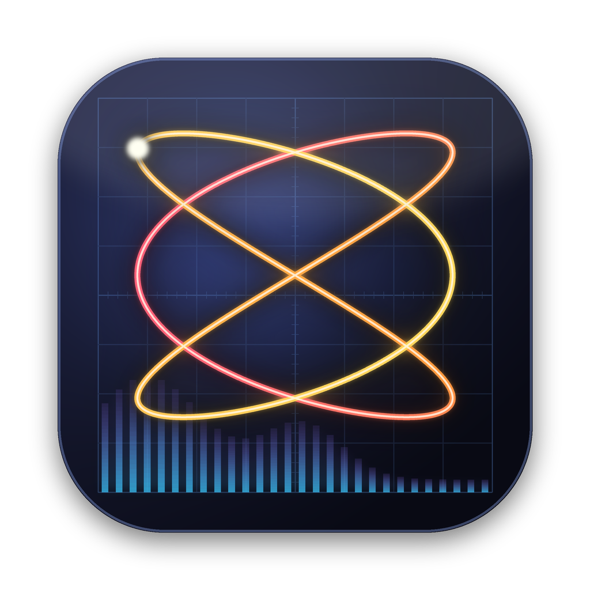

# Moritz

<p align="center">
  
</p>

Moritz is a Max-like environment for sound and music computing. You build
patches by placing boxes on a canvas and connecting them with cables, and you
hear the result as you play with them. It works the way Max does, so what
you know from Max carries over, and it runs on macOS, Linux and Windows.

Moritz was made for teaching. Every object is a short piece of readable C++
with no dependencies beyond three libraries (FLTK for the interface,
miniaudio for audio, RtMidi for MIDI), so students can open the box and see
how a phase vocoder, a granulator or k-means actually works. It brings
together, in one free and open system, the research tools of its author:
the *sparkle* phase vocoder, *condec* convolution, the *nebula* granulator,
and the signal processing, analysis and learning of *Musil*.

## What you can do with it

- **Synthesis**: oscillators, noise, FM, granular synthesis (`nebula~`, and a
  granulator built from `poly~`), polyphonic instruments.
- **Sound files**: buffers, players, looping, recording, waveform views, and
  offline rendering of whole patches into sound.
- **Filters and effects**: resonant and state-variable filters, biquads
  designed and drawn on screen, delays, a reverb, zero-latency convolution
  with any impulse response.
- **The spectrum**: a phase vocoder that stretches time and shifts pitch
  while keeping the formants, cross-synthesis between two sounds, spectral
  envelopes, and the building blocks to make your own (`pfft~`).
- **Space**: ambisonics up to order 5, decoding to speakers, and 3D sound on
  headphones from measured head responses.
- **Listening machines**: descriptors, onsets, tempo and beats, key,
  chromagrams and MFCCs, the form of a piece, live or on recordings, drawn
  by `plot`.
- **Atoms and types**: matching pursuit explains a sound as a sum of atoms
  (windowed cosines, or pieces of other recordings: a voice made of kitchen
  sounds); sound types turn a recording into sequences of symbols at three
  levels, from short sounds to sections, and make new music from them with
  n-grams, Markov models or a factor oracle.
- **Separation and learning**: non-negative matrix factorisation and
  harmonic/percussive separation, nearest neighbours, k-means, PCA and
  regression, to map gestures to sounds or to let the computer sort sounds by
  itself.
- **MIDI**: keyboards, controllers, notes in and out, polyphonic voices.
- **Max patches**: File > Import from Max opens `.maxpat` files, converting
  what Moritz knows and reporting the rest.
- **A language**: Moritz has a language of its own, a Lisp with vectors for
  numbers, in which patches are written and in which you can program what is
  easier to write than to draw: algorithmic composition, orchestration with
  sample databases (Orchidea), scores and MusicXML, offline signal processing
  and analysis, statistics and learning. Write it in the code editor (File >
  New Code; Cmd-Enter runs the paragraph at the cursor, Tab completes, the
  help of the name under the cursor is beside it) or at the Console's
  prompt. Its libraries are in `language/`; `moritz --run` and
  `moritz --repl` run it from a terminal (see below).

The complete list of objects is in [OBJECTS.md](OBJECTS.md).

## The name

Max, the patching environment Moritz follows, was named after Max Mathews,
the pioneer of computer music. In German, Max never goes far without Moritz:
*Max und Moritz* (1865), Wilhelm Busch's story of two boys and their seven
pranks, is one of the best-known picture books in the language. Moritz is
Max's companion: it works the way Max does, and gets up to some mischief of
its own. (Busch's two boys are hiding somewhere in the program, too.)

## Getting started

Download Moritz for your system from the
[releases](https://github.com/CarmineCella/Moritz/releases), unzip it and open
it. On macOS, a downloaded app is blocked the first time: open it once, then
click **Open Anyway** in System Settings > Privacy & Security (or run
`xattr -dr com.apple.quarantine Moritz.app`).

Moritz opens on the **browser**, the place to start:

- **Tutorials**: ten patches that explain themselves as you play with them:
  a first patch, numbers and messages, sound files, filters, the spectrum,
  grains, sound in space, separating sounds, listening machines, atoms and
  types.
- **Examples**, by category (the folders of `examples/`): first steps,
  synthesis, generative music, filters and effects, samples, spectral
  processing, space, atoms and types, analysis and MIR, learning, MIDI. Each
  one says what it shows at the top.
- **Objects**: every object with its reference (arguments, messages, inlets,
  outlets), opening its help patch, a small working example with notes.

Turn audio on with the **Audio** button in the toolbar (Cmd+/), and use the
search box to find anything. The toolbar also zooms the patch (Cmd+ and Cmd-,
Cmd+0 for 100%), opens the browser and the console, records what you hear
(the quick recorder) and shows the CPU load and the output level.

Help > Documents opens the PDFs in `docs/`, such as "Sound decomposition
strategies for creative hybridizations", on the methods of the atoms and
types objects.

## Patching

Moritz follows Max's conventions:

- **Edit and locked mode**: **Cmd+E** switches. In edit mode you build; in
  locked mode you play (click buttons and messages, drag sliders and
  numbers). New patches start in edit mode, opened ones locked.
- **Making boxes**: double-click the canvas and type (`cycle~ 440`); a list of
  matching objects helps you complete it. Shortcuts with the mouse over the
  canvas: **n** object, **m** message, **f** and **i** number boxes, **b**
  button, **t** toggle, **c** comment. Patch > New lists every object by
  category.
- **Connecting**: drag from an outlet (the bottom edge of a box) to an inlet
  (the top edge). Rest the mouse on a port to see what it expects or sends.
- **Editing**: select by clicking or dragging a rectangle; Option-drag copies;
  Cmd+X, Cmd+C, Cmd+V and Cmd+D cut, copy, paste and duplicate, also between
  patches; Cmd+Z undoes.
- **Help and reference**: right-click any box and choose Help (or
  Option-click it in locked mode) for a working example, or Reference for
  every argument, message, inlet and outlet. Help windows have a Reference
  button too.
- **Right-click** also offers what a box can do: load or save a `buffer~`,
  open a `plot`'s window or export it, choose the file of `sfplay~` and
  `sfrecord~`. Double-clicking an object that names a `buffer~` (locked)
  shows its waveform, as in Max.
- **Zoom**: Cmd+ and Cmd- (or the toolbar) zoom the patch; View > Interface
  makes the whole interface larger or smaller.
- **Code view**: Cmd+T shows the patch as text beside the drawing. Edit
  either and the other follows.
- **Subpatchers and abstractions**: `p name` holds a patch inside a box; any
  `name.moritz` file next to your patch, or in the library, becomes an
  object. Double-click to open them.
- **Several patches** play at once and share their `send`/`receive` and
  `buffer~` names, as in Max.
- **Console** (Shift+Cmd+M): what `print` prints, errors, audio and file
  events. Its toolbar button shows a red dot after an error.
- **Quick recorder** (Extras, or the toolbar's Record button): records what
  goes to the speakers into a 24-bit WAV file in Music/Moritz Recordings.
- **Links**: a `link` box opens a document, a folder or a web page with a
  click.
- **Multichannel**: the sound card opens with all its channels, so
  `dac~ 1 2 3 4 5 6 7 8` plays on eight speakers and ambisonic decoders
  reach every speaker (Audio Setup can limit the channels). A patch can also
  use more channels than the card has: they are metered and recorded by the
  quick recorder, and rendered offline, just not heard.
- **Binaural monitor** (Extras): listen to a multichannel or ambisonic
  piece on headphones. Every output channel becomes a speaker around you
  (a ring, or the directions you type), rendered with the MIT KEMAR head
  responses on channels 1 and 2.
- **Channel tester** (Extras): bursts of noise on one channel at a time, or
  stepping through all of them, to find which speaker is which.
- **Audio and MIDI**: Patch > Audio Setup picks the devices; Moritz listens
  to every MIDI input and, on macOS and Linux, offers a virtual output port
  called "Moritz" (on Windows, Patch > MIDI Setup picks an output device).
- **Your own library**: put abstractions (and their `.help.moritz`) in
  `~/Documents/Moritz/library` and they work like built-in objects.

Numbers follow Max's types: an argument written with a point (`2.`) makes an
object work in decimals, an integer argument or none in integers, so `7 / 2`
is 3 and `7 / 2.` is 3.5.

A patch is a text file that is easy to read and to write by hand:

```lisp
(patch
  (obj osc  cycle~ 440 (pos 40 130))
  (obj gain *~ 0.2     (pos 40 180))
  (obj out  dac~       (pos 40 240))
  (connect osc 0 gain 0)
  (connect gain 0 out 0)
  (connect gain 0 out 1))
```

## Building from source

Moritz builds with `make`; the first run downloads FLTK 1.4.4, miniaudio and
RtMidi into `deps/`.

- **macOS** (Xcode command line tools, cmake, curl): `make` builds
  `Moritz.app`, a universal bundle; `make run` opens it.
- **Linux** (a C++17 compiler, cmake, curl, the ALSA and X11 development
  packages): `make` builds `build/linux/Moritz/moritz`. On Debian or Ubuntu:

  ```sh
  sudo apt install build-essential cmake curl libasound2-dev libx11-dev libxext-dev \
    libxft-dev libxinerama-dev libxcursor-dev libxrender-dev libxfixes-dev libfontconfig1-dev
  ```

- **Windows**: in the MSYS2 MINGW64 shell, after
  `pacman -S make curl zip mingw-w64-x86_64-gcc mingw-w64-x86_64-cmake`,
  `make` builds `build/windows/Moritz/moritz.exe` (static, no DLLs). It can
  also be cross-compiled from a Mac or Linux with MinGW-w64: `make windows`.

`make dist`, `make linux-dist` and `make windows-zip` package each system.
`make notarize SIGN_ID="Developer ID Application: Name (TEAMID)"` signs and
notarizes the Mac app for distribution.

Every push to GitHub builds Moritz on all three systems and runs every
example, help patch, tutorial and library abstraction through
`tools/test-patches.sh`; a tag `v<version>` publishes a release. The same
test runs locally: `tools/test-patches.sh ./moritz`.

## Command line

- `moritz --run file.moritz [-- args...]` evaluates a file of the Moritz
  language without opening a window; `moritz --repl` gives a prompt. A file
  names the libraries it needs: `load "music"` loads `language/music.moritz`.
- `moritz --no-audio [patch...]` opens with audio off, for a machine whose
  audio device misbehaves.
- `moritz --import patch.maxpat [out.moritz]` converts a Max patch, as File >
  Import from Max does.
- `moritz --render patch.moritz seconds [out.wav] [actions...]` runs a patch
  offline, faster than real time and without a sound card, prints the level
  of each channel and can write the sound to a file. Actions:
  `bang=<id>`, `send=<id>:<message>` (both can wait: `bang=go@4.5`),
  `midi=<seconds>:<bytes>` (a MIDI message in), `png=<file>` (draws the patch
  as it looks after the render; `edit` draws it in edit mode),
  `extra=<patch>` (runs a second patch alongside, as help patches run).
  A box inside a subpatcher is named as `p1/osc`.

## Sounds

The sounds in `examples/sounds/` come from the examples of Musil: a voice,
an excerpt of Beethoven's Seventh Symphony, drums, a guitar phrase, a bell, a
gong, two mixes for separation, and the impulse response of the
Concertgebouw in Amsterdam. For music information retrieval:
"The Stars and Stripes Forever" by John Philip Sousa, played by the United
States Marine Band (2017; public domain as a work of the U.S. government,
from the band's "Complete Marches of John Philip Sousa", via Wikimedia
Commons), and the preludes in C minor and D major of Bach's Well-Tempered
Clavier, Book 1, played by Kimiko Ishizaka (the Open Well-Tempered Clavier,
CC0, welltemperedclavier.org). The kitchen and people sounds in
`examples/sounds/kitchen` and `examples/sounds/people`, used as dictionaries
for matching pursuit, are the author's recordings. The clarinet notes in
`examples/sounds/clarinet` (B-flat clarinet, ordinario, every pitch at pp,
mf and ff, shortened to 1.5 s) come from TinySOL (Cella, Ghisi, Lostanlen,
Lévy, Fineberg and Maresz, IRCAM, CC BY 4.0). Short excerpts of John Cage
speaking and of a Beach Boys song are used for the rematch example.

## License and credits

Moritz is released under the BSD 2-Clause License; see `LICENSE`. Created by
Carmine-Emanuele Cella (2026).

`hrtf~` and `binaural~` use the MIT KEMAR head-related impulse responses by
Bill Gardner and Keith Martin, MIT Media Laboratory (1994), "HRTF Measurements
of a KEMAR Dummy-Head Microphone".

The drawing of Max and Moritz (Shift+Cmd+J in Moritz) is Wilhelm Busch's own, from *Max und Moritz*
(1865), in the public domain (scan from Wikimedia Commons, "Max und Moritz
(Busch) 001.png").
